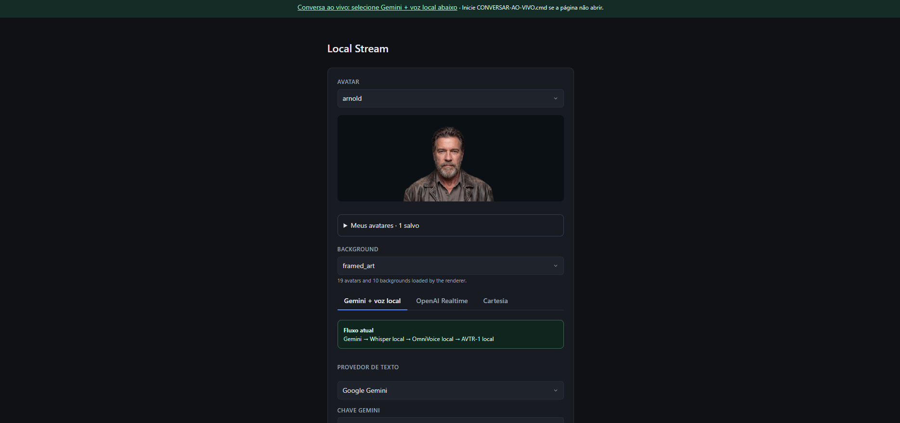
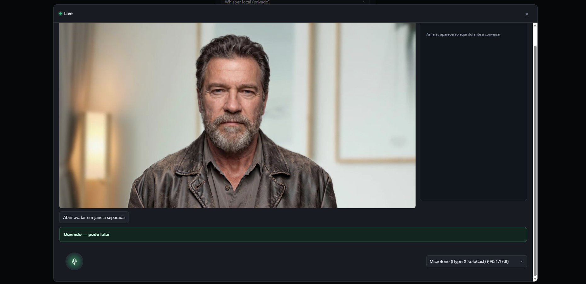

# AVTR-1 para Windows — avatar e voz locais

Adaptação comunitária do [AVTR-1 original](https://github.com/avaturn-live/avtr-1), para Windows nativo, sem WSL. Não é uma distribuição oficial da Avaturn.

**Comece pelo [guia de instalação para Windows](WINDOWS.md).**

- Avatar local com AVTR-1, TensorRT e CUDA.
- Voz local OmniVoice com clonagem opcional e transcrição Whisper local ou API.
- Texto por Gemini, OpenAI, DeepSeek, Grok ou servidor compatível, como LM Studio.
- Silero VAD, diálogos laterais, janela flutuante, fotos como avatares personalizados.
- Configurações persistidas em SQLite na pasta do projeto.

Instalação: baixe o ZIP, extraia e abra **`INSTALAR-WINDOWS.cmd`**. Coloque a pasta extraída no disco desejado e execute o instalador nela. A aplicação, o OmniVoice e os caches ficam dentro dessa mesma pasta, sem seleção de destino.

O instalador verifica os pré-requisitos antes de instalar e mostra o que falta. Para apenas verificar, abra **`VERIFICAR-REQUISITOS.cmd`**. Código de voz, modelos, caches e dados ficam em pastas separadas.

Depois, entre no Hugging Face e execute `PREPARAR-MODELOS.cmd`, conforme o [guia Windows](WINDOWS.md).
Uso diário: **`CONVERSAR-AO-VIVO.cmd`** → http://localhost:7860.

Modelos, chaves, banco de configurações, vozes e fotos pessoais não estão incluídos neste repositório. Cada pessoa precisa obter o próprio acesso aos modelos e às APIs que escolher. O modo local não exige serviço externo de avatar.

Os arquivos de licença originais foram preservados: [mapa de licenças](LICENSE.md). Este fork não altera as permissões de uso dos componentes originais.

## Interface

### Configuração do avatar e dos provedores

Escolha o avatar, o fundo, o provedor de texto e as opções de voz e transcrição.

### Conversa ao vivo

Avatar em vídeo, painel de diálogos, indicação de atividade e seleção de microfone. O vídeo também pode ser aberto em uma janela separada.

## Requisitos para Windows

| Item | Requisito / referência |
| --- | --- |
| Sistema | Windows 10 ou 11 de 64 bits, arquitetura x64; sem WSL |
| GPU | NVIDIA com CUDA. Configuração testada: **RTX 4060 Ti com 16 GB de VRAM**; outras placas e quantidades de memória não foram validadas |
| Driver | Driver NVIDIA com suporte a **CUDA 12.8 ou superior** |
| Python | **Python 3.12 x64**, com Python Launcher (`py`) |
| Git | Git para Windows disponível no terminal |
| Bibliotecas do sistema | Microsoft Visual C++ Redistributable x64 |
| Armazenamento | Espaço para três ambientes Python, modelos e caches. O instalador mostra o espaço livre e avisa abaixo de 50 GB; esse valor é uma margem de planejamento, não um mínimo medido |
| Navegador | Chrome ou Edge, com permissão de acesso ao microfone em localhost |
| Áudio | Microfone e saída de áudio; referência de voz opcional para clonagem |
| Internet | Necessária para instalar dependências e baixar modelos; também para os provedores de API que você escolher |
| Modelos | Conta Hugging Face com acesso liberado ao [AVTR-1](https://huggingface.co/avaturn-live/avtr-1) e condições aceitas |
| Provedor de texto | Sua chave de API, se escolher um serviço externo; ou servidor local compatível, como LM Studio, com modelo carregado |

O instalador verifica os pré-requisitos antes de instalar as dependências. Ele não instala automaticamente Python, Git, driver NVIDIA ou Visual C++. Confira o [passo a passo para Windows](WINDOWS.md) para os links e orientações.

Avatar, OmniVoice e Whisper local compartilham os recursos do computador. O desempenho e a latência dependem da GPU, do modelo e do provedor escolhido; não há garantia de tempo real em outras máquinas. A instalação completa em um Windows limpo ainda precisa de validação.
